# Dog Breed Explorer

An offline-first React Native app for browsing and filtering all 283 breeds from [dogapi.dog v2](https://dogapi.dog/docs/api-v2). It's built with Expo SDK 58, TypeScript (strict), Expo Router, Zustand, TanStack Query, and SQLite.

## Screenshots

iOS (iPhone 18 Pro simulator):

| Breed list (light) | Breed list (dark) | Filters |
| --- | --- | --- |
| 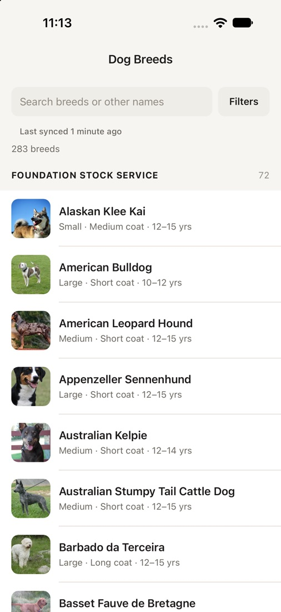 | 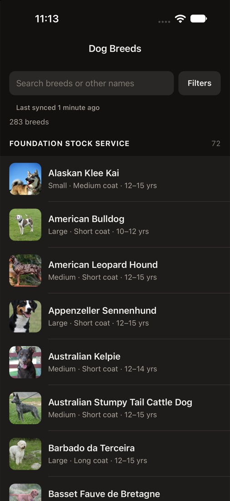 | 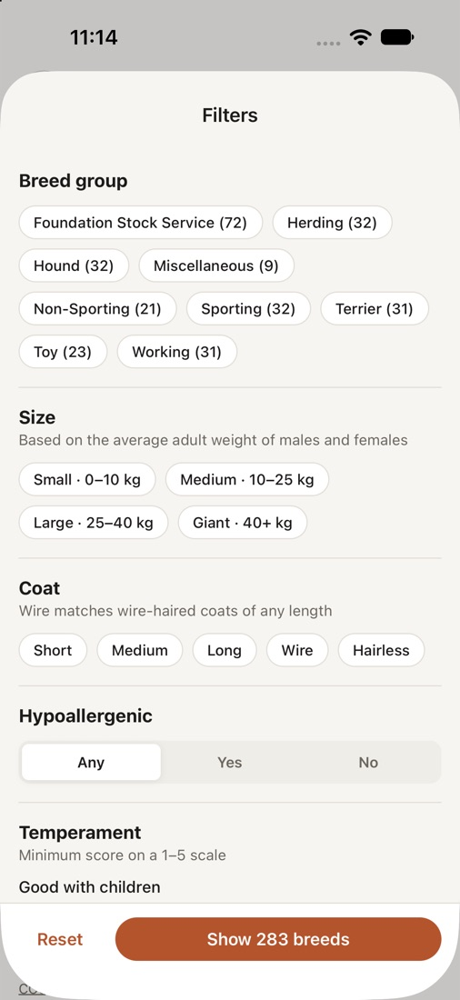 |

| Detail: overview | Detail: traits | Detail: gallery + attribution |
| --- | --- | --- |
| 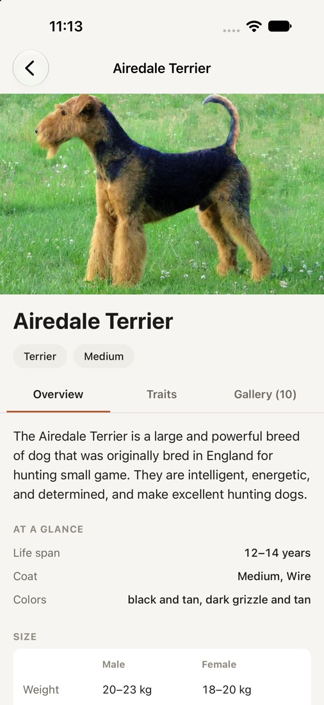 | 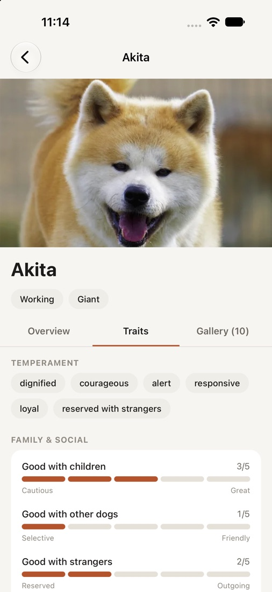 | 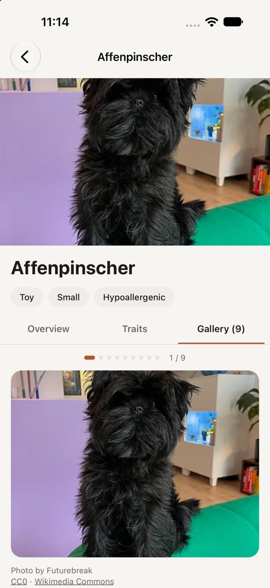 |

Android ("Medium Phone" emulator, API 37):

| Filters applied | Offline banner | Gallery + attribution |
| --- | --- | --- |
| 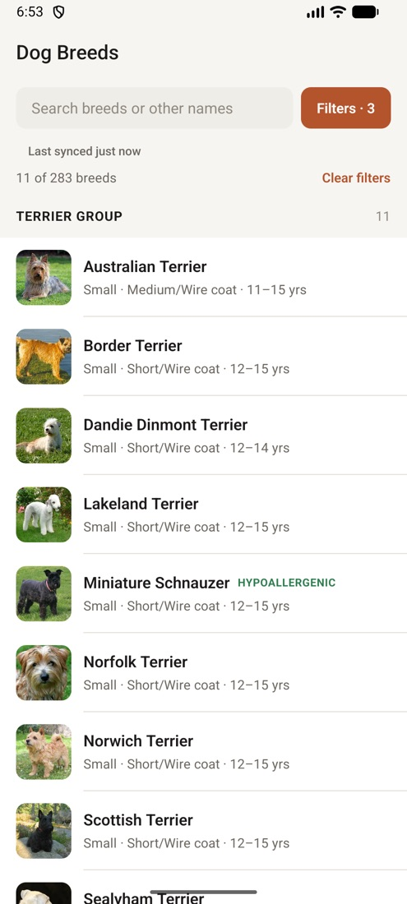 | 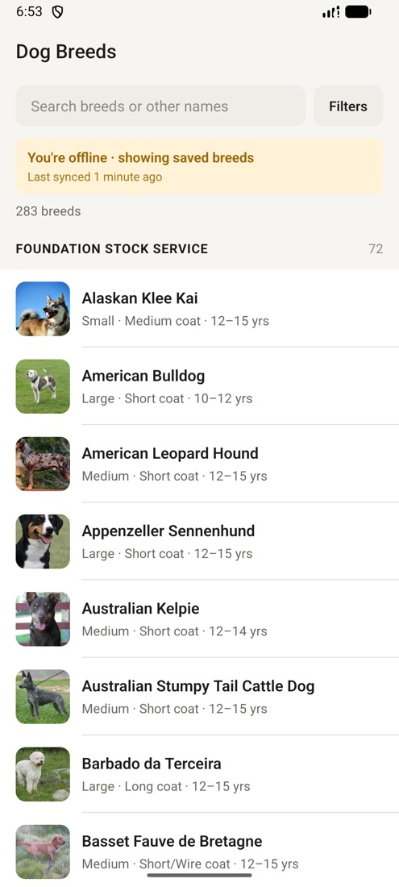 | 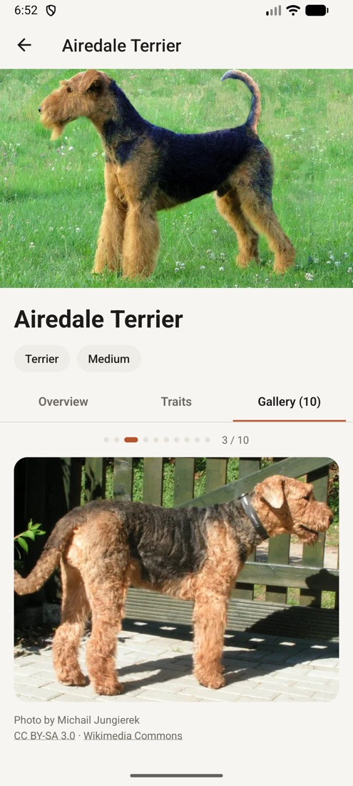 |

| Breed list (light) | Breed list (dark) |
| --- | --- |
| 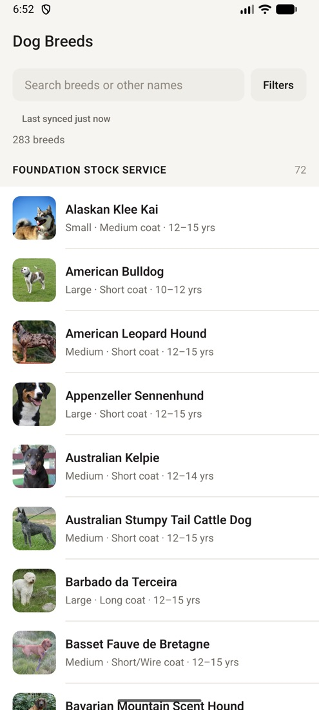 | 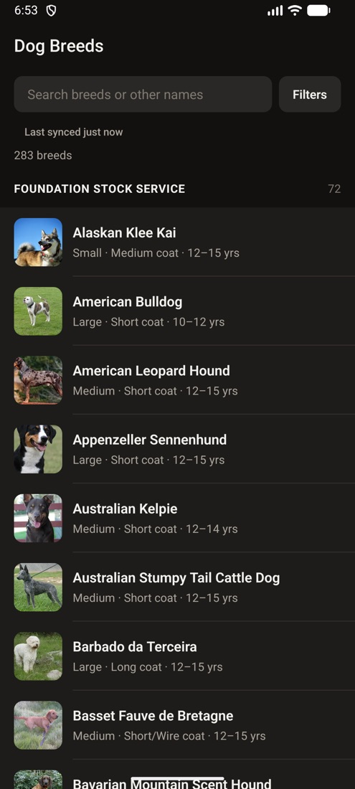 |

## Demo

Both videos start from a **fresh install** (app data wiped), so they show the first full sync of all 283 breeds.

- [docs/demo-android.mp4](docs/demo-android.mp4) is a native Release build on the Android emulator, driven with real taps. It covers the first sync, scrolling, search, the Overview, Traits and Gallery tabs, the swipeable gallery and fullscreen view, filters applied, going offline (banner with cached data), coming back online (automatic background sync), and dark mode.
- [docs/demo-ios.mp4](docs/demo-ios.mp4) is Expo Go on the iOS simulator. It covers the first sync, light and dark mode, all three detail tabs, and the filters screen.

## Quick start

Requires Node 20+ and either Xcode (iOS Simulator) or Android Studio (emulator).

```bash
npm install
cp .env.example .env
npm run ios        # or: npm run android
```

`npm run ios` starts Metro and opens the app in Expo Go on the simulator. The first run downloads Expo Go automatically. No native build or API key is needed.

Other scripts:

| Command | What it does |
| --- | --- |
| `npm test` | Jest + React Native Testing Library (85 tests) |
| `npm run typecheck` | `tsc --noEmit` in strict mode |
| `npm run lint` | ESLint (`no-explicit-any` is an error) |
| `npm run ios:release` | Native Release build on the iOS simulator (needs CocoaPods) |
| `npm run bundle:analyze` | Per-package bundle breakdown (after `npx expo export --dump-sourcemap`) |

### Environment variables

All are optional and have defaults (`src/config/env.ts`):

| Variable | Default | Purpose |
| --- | --- | --- |
| `EXPO_PUBLIC_API_BASE_URL` | `https://dogapi.dog/api/v2` | API root |
| `EXPO_PUBLIC_PAGE_SIZE` | `48` | Page size requested (the API defaults to 30) |
| `EXPO_PUBLIC_PAGE_CONCURRENCY` | `3` | Pages fetched in parallel |
| `EXPO_PUBLIC_REQUEST_TIMEOUT_MS` | `10000` | Per-request timeout |
| `EXPO_PUBLIC_STALE_AFTER_MINUTES` | `360` | When cached data is considered stale |
| `EXPO_PUBLIC_THUMB_CACHE_MB` | `20` | Disk budget for list thumbnails |
| `EXPO_PUBLIC_FULL_CACHE_MB` | `80` | Disk budget for medium and large images |

## Architecture overview

The app treats **SQLite as the on-device source of truth**. On launch, the catalog is read from SQLite into a normalized Zustand store and the UI renders immediately, with no network on the critical path. A sync engine then refreshes the data in the background. It fetches the 6 API pages through a small concurrency pool with per-page retries and exponential backoff, normalizes the messy source records through type guards, and streams each page into both SQLite and the store. The list therefore fills in progressively on first launch and updates in place afterwards.

TanStack Query decides *when* to sync: staleness, reconnect, app foreground, pull-to-refresh, and pausing while offline. The sync engine decides *how*. The query result is just a small sync report, so the data is never duplicated in React Query's cache. A sync is classified as complete, partial, or failed. Only a complete sync prunes removed breeds or advances "Last synced". A partial failure keeps the cached data and shows an error banner with Retry.

Images go through a custom disk cache with separate LRU byte budgets for thumbnails and full-size variants, indexed in SQLite. The list uses thumbnails only, which are prefetched for every breed on Wi-Fi. The gallery loads medium images, and the fullscreen viewer upgrades to large. Full details are in [docs/ARCHITECTURE.md](docs/ARCHITECTURE.md).

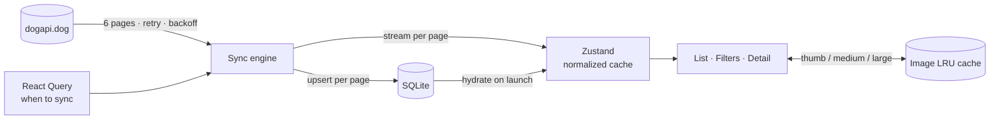

**Data flow: API → Cache → UI.** The network only ever writes to the cache (SQLite plus the store), and the UI only ever reads from the cache.

## Key technical decisions

Full rationale and trade-offs are in [docs/DECISIONS.md](docs/DECISIONS.md).

- **State management: Zustand.** It provides a normalized `byId` cache with selector-level subscriptions, so rows re-render only when their own data changes. It's also writable from outside React, which lets the sync engine be a plain, unit-tested module. Redux Toolkit would work but adds ceremony with no benefit here, and Context would re-render every consumer during a streaming sync.
- **Database: SQLite (expo-sqlite).** It gives per-row upserts and transactions, so a partial sync never corrupts the catalog. It supports pruning by id and an indexed LRU table for the image cache. AsyncStorage would force one large JSON blob (~1.8 MB) to be rewritten on every update. WatermelonDB is built for much larger, two-way-synced datasets.
- **Offline sync strategy:** cache-first reads, background refresh triggered by staleness, reconnect, or foreground. Pages are upserted as they arrive. Rows are pruned only after a provably complete sync, and "Last synced" only advances then. Offline, queries pause and a banner shows what's being displayed and how old it is.
- **Messy data:** the live API differs from the brief (30 per page by default, up to 10 images, "wire" is a coat *type*, one breed has empty traits, coat, and origin, and 244 image attributions have null fields). Every field is read from `unknown` through guards, and gaps render as explicit empty states, never as zeros.

## Performance report

See [docs/PERFORMANCE.md](docs/PERFORMANCE.md) for methodology.

| Metric | Result |
| --- | --- |
| Main bundle (Hermes, iOS / Android) | **2.37 MB / 2.37 MB**. App code is 2.7%, React Native + router ~70% |
| Memory, Release build, iOS simulator | **85 MB** cold launch with cached list, **93 MB** during first full sync. Target < 150 MB |
| Memory, Release build, Android emulator | **107 MB** PSS on launch, **133 MB** after scrolling the full list down and up |
| Cold start → cached list visible (Release) | iOS **2.0–2.5 s**, Android **1.0–1.5 s**. Target < 3 s |
| Memory, Release, during scroll | TODO: screenshot |
| Profiler: full 283-breed list render | TODO: screenshot |
| FPS during scroll | Android emulator: median frame 34 ms, the same as Android's own Settings app on that emulator (~30 fps emulator ceiling). Needs a physical device to prove 60 fps. TODO |

Main performance techniques: rows render primitive projections of the heavy nested records, with stable identities so `React.memo` holds. Fixed heights give an exact `getItemLayout`. The list loads thumbnail-only images from a synchronous cache index. Search is debounced, and filtering runs in memory over the projections.

## Testing

```bash
npm test
```

85 tests across 11 suites, covering:

- Normalization against **real API fixtures**, including the malformed records
- Size and coat derivation, filter and search semantics, and section grouping
- HTTP retry, backoff, timeout, and error classification
- Paginated merge, dedupe, and partial page failure
- The sync engine's complete, partial, and failed paths, plus in-flight dedupe
- Banner states, SQLite migrations, repository guards, and the transaction queue
- LRU eviction planning
- Components: trait scales, attribution, retry banner, breed row, filter panel → store

**E2E (bonus):** [`.maestro/browse-and-filter.yaml`](.maestro/browse-and-filter.yaml) searches, opens a breed, walks all three tabs, then applies filters. It targets a development build (`npx expo run:ios`, then `maestro test .maestro`). It hasn't been run yet because Maestro isn't installed on the machine that produced this build.

**CI (bonus):** [`.github/workflows/ci.yml`](.github/workflows/ci.yml) runs typecheck, lint, tests with coverage, and an Android export with a bundle report on every push and PR.

## Accessibility

- Every interactive element has a role and label.
- Filter chips expose a checked state and segmented controls use radio semantics.
- Trait bars are `progressbar`s with values ("Energy: 4 out of 5. Mellow to High drive.").
- Rows read as one sentence ("Poodle. Medium · Long coat · 12–15 yrs. Hypoallergenic").
- The sync banner is a polite live region.
- Group headers are headers, so VoiceOver's rotor can jump between breed groups.

## Project structure

```
docs/          ARCHITECTURE.md · DECISIONS.md · PERFORMANCE.md · images/
src/
  app/         routes (Expo Router, typed)
  screens/     screen composition
  components/  app · common · list · filters · detail · sync
  api/         http, guards, dogApi
  domain/      types, normalize, derive, filters, search, format
  db/          SQLite + migrations + repository
  images/      LRU policy + file cache
  store/       Zustand stores
  sync/        sync engine, React Query wiring, hooks
  hooks/  theme/  config/
  __tests__/
.maestro/      E2E flow
scripts/       bundle report
```
