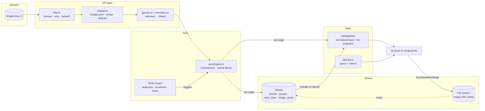
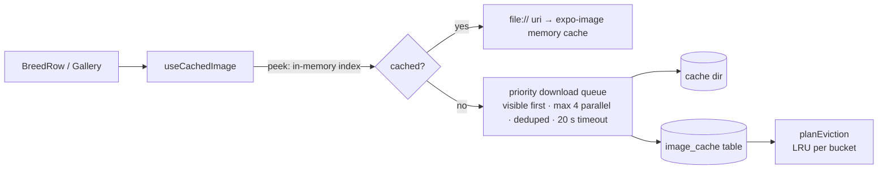

# Architecture

## Overview

The app is offline-first. **SQLite is the source of truth on the device.** The network only refreshes it, and the UI only ever reads from an in-memory store hydrated from SQLite. As a result:

- A cold start with cached data never waits on the network. The list renders from SQLite, then a background sync runs if the data is stale.
- Network failures can never blank the screen. In the worst case the user sees cached data plus a banner explaining what failed.
- Every layer below the UI can be tested in plain Node without native modules (see `src/__tests__`).

## Data flow



### Launch sequence

1. `CatalogBootstrap` opens SQLite (running migrations if needed), loads all breeds, groups, and sync metadata, and calls `catalogStore.hydrate()`. The image index is warmed in parallel.
2. Once hydrated, the app renders. `BackgroundTasks` mounts the catalog sync query.
3. The query is seeded with `initialData` / `initialDataUpdatedAt` from the last *complete* sync, so React Query decides freshness itself. Fresh data means no request; stale or partial data means a background sync.
4. On a first launch (empty DB) the sync starts immediately. Each page is written to the store as it arrives, so the list fills in progressively, with a "Syncing breeds (3/6 pages)" indicator.

### Sync

`syncEngine.syncCatalog()`:

1. Fetches `/groups` in parallel with the breed pages (filter labels and section headers).
2. `fetchBreedCatalog` loads page 1, reads `meta.pagination.last` and `records`, then loads pages 2..N through a concurrency pool of 3 (`EXPO_PUBLIC_PAGE_CONCURRENCY`). Each request has its own timeout and retries with exponential backoff plus jitter. One page failing does not abort the others.
3. Each page is normalized, pushed to the store, and upserted into SQLite as it arrives.
4. **Complete sync** (no failed pages, record count matches `meta.records`): rows no longer returned by the API are pruned, and `lastSuccessAt` advances.
5. **Partial sync**: nothing is pruned, `lastSuccessAt` does *not* advance, and the banner shows "Showing cached data · Couldn't refresh 2 of 6 pages…" with a Retry button.
6. **Failed sync** (page 1 unreachable): cached data stays and the error is recorded. React Query retries transient failures twice more with backoff.

Concurrent callers share one in-flight sync, so pull-to-refresh during an automatic sync is a no-op.

Triggers:

| Trigger | Mechanism |
| --- | --- |
| App launch with stale data | `staleTime` vs. seeded `initialDataUpdatedAt` |
| Network returns | NetInfo → `onlineManager` → `refetchOnReconnect` |
| App foregrounded | `AppState` → `focusManager` → `refetchOnWindowFocus` (only if stale) |
| Pull to refresh / Retry | `refetch()` |
| Offline | `networkMode: 'online'` pauses queries instead of failing them |

### Detail refresh

Opening a breed renders immediately from the store. `useBreedDetail` calls `GET /breeds/:id` in the background (stale after 1 hour), writes the result to SQLite (`detail_synced_at`), and updates the store. Offline, the request pauses silently.

### Images



- Downloads have two priorities. Images on screen (`visible`) always start before Wi-Fi prefetch (`background`), and a queued prefetch is promoted the moment its image appears on screen. Without this, a gallery photo could wait behind ~280 queued thumbnails on a slow connection.
- Two budgets: **thumb** (20 MB) and **full**, for medium and large (80 MB). Both can be set in `.env`. Thumbnails never get evicted to make room for a large photo.
- The index lives in SQLite and is mirrored in memory, so `peek()` is synchronous and recycled rows never flash a placeholder for a cached image.
- Last-access times are written to SQLite in batches, at most every 3 s, rather than once per row render.
- If the OS purges the cache directory, missing files are detected at startup and removed from the index.

## Module map

```
src/
├── app/                 Expo Router routes (thin: wire params → screens)
├── screens/             Screen composition
├── components/
│   ├── app/             Providers, bootstrap, background tasks
│   ├── common/          Button, Chip, CachedImage, ErrorBoundary, Empty/Error states
│   ├── list/            BreedList, BreedRow, GroupHeader, SearchBar, FilterButton, ResultSummary
│   ├── filters/         FilterPanel, ChipGroup, SegmentedControl, TraitThresholdRow, FilterFooter
│   ├── detail/          Tabs, Overview/Traits/Gallery, TraitScale, ImageAttribution, FullscreenViewer
│   └── sync/            SyncStatusBanner (container) + SyncBannerView (presentational)
├── api/                 http (retry/backoff/timeout), guards (unknown → typed), dogApi
├── domain/              types, normalize, derive (size/coat), filters, search, format, trait catalog
├── db/                  SQLite connection, migrations, catalog repository
├── images/              cache policy (pure) + file-system LRU cache
├── store/               Zustand catalog + filter stores
├── sync/                sync engine, services wiring, React Query client & hooks, banner logic
├── hooks/               debounce, clock, network status, cached image, filtered entries
├── theme/               light/dark tokens, themed StyleSheet factory
└── __tests__/           Jest + React Native Testing Library
```

Dependency direction runs `app → screens → components → hooks/store/sync → domain/api/db`. `domain/` imports nothing from React or React Native.

## SQLite schema

Migrations are versioned with `PRAGMA user_version` (`src/db/database.ts`) and run in a transaction each.

```sql
CREATE TABLE breeds (
  id               TEXT PRIMARY KEY NOT NULL,
  name             TEXT NOT NULL,
  group_id         TEXT,
  payload          TEXT NOT NULL,
  synced_at        INTEGER NOT NULL,
  detail_synced_at INTEGER
);
CREATE INDEX idx_breeds_group ON breeds (group_id);

CREATE TABLE breed_groups (
  id        TEXT PRIMARY KEY NOT NULL,
  name      TEXT NOT NULL,
  breed_ids TEXT NOT NULL,
  synced_at INTEGER NOT NULL
);

CREATE TABLE sync_state (
  key   TEXT PRIMARY KEY NOT NULL,
  value TEXT NOT NULL
);

CREATE TABLE image_cache (
  url         TEXT PRIMARY KEY NOT NULL,
  bucket      TEXT NOT NULL,
  file_name   TEXT NOT NULL,
  bytes       INTEGER NOT NULL,
  last_access INTEGER NOT NULL
);
CREATE INDEX idx_image_cache_lru ON image_cache (bucket, last_access);
```

- `payload` is the **normalized** `Breed` wrapped as `{ v, breed }`. Bumping `v` makes old rows fail the guard and be ignored until the next sync rewrites them, with no migration needed for shape changes.
- `name` and `group_id` are real columns so ordering and grouping can move into SQL if the dataset grows. At 283 rows, filtering in memory is faster than a query round-trip (see DECISIONS.md).
- `sync_state` holds `lastSuccessAt`, `lastAttemptAt`, `lastOutcome`, and `lastError`, which feed the freshness banner after a restart.
- WAL mode is enabled. All transactions go through a small queue (`serializeTransactions`) because parallel page writes otherwise hit "cannot start a transaction within a transaction". A regression test covers this.

## Error handling

| Layer | Strategy |
| --- | --- |
| HTTP | Typed `HttpError` / `TimeoutError` / `NetworkError`. Only transient errors are retried. `Retry-After` is honored. |
| Parsing | Every field read from `unknown` through guards. Invalid records are counted and skipped, never thrown. |
| Sync | Complete / partial / failed outcomes, persisted and surfaced in the banner. |
| Storage | `CatalogBootstrap` shows a recoverable error if SQLite cannot open. |
| Rendering | `ErrorBoundary` around the app, the list, the filters panel, and each detail tab (keyed per tab, so switching tabs resets it). The route-level `ErrorBoundary` from Expo Router covers navigation crashes. |
